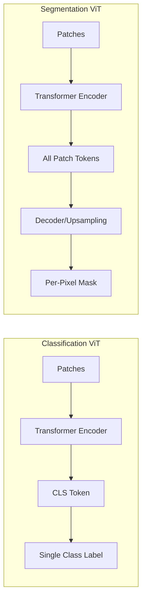
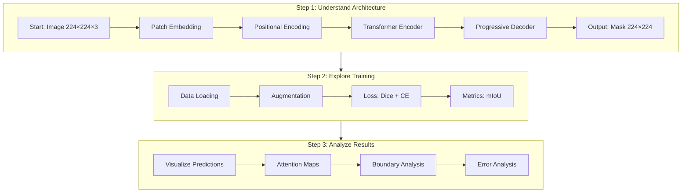

# Vision Transformer for Semantic Segmentation - AI Learning Guide

## For Users of Cursor, Claude, GitHub Copilot, and Other AI Assistants

This guide helps you explore and understand this Vision Transformer implementation through AI-assisted learning. Use it to navigate the codebase systematically with your AI coding assistant.

## What This Project Teaches

- How Vision Transformers adapt from classification to **dense prediction** (per-pixel labels)
- Patch embedding: Converting images to tokens
- Self-attention for spatial reasoning
- Decoder design: Upsampling from patches back to pixels
- Training segmentation models from scratch
- Evaluating with IoU and analyzing failure modes

## Dataset: Oxford-IIIT Pets

7,349 images of cats and dogs with pixel-level masks. Binary segmentation: pet vs. background.
- Perfect learning size: trains in ~2 hours on M-series Mac
- Real-world complexity: varied poses, breeds, lighting, occlusions

## Understanding Classification vs Segmentation

The key difference between image classification and segmentation transformers:



## Learning Path: From Input to Output



## How to Use This Guide with AI

### Start Here: First Conversation

**You:** "I want to understand this Vision Transformer segmentation project. Where should I start?"

**AI Assistant will help you:**
1. Get high-level overview of the architecture
2. Understand the data flow from image to segmentation mask
3. Navigate to the most important files

### Step-by-Step Learning Journey

#### Session 1: Understanding the Architecture (30 min)

**Goal:** Understand how images become segmentation masks

**Ask your AI:**
1. "Explain the overall architecture in `vit/segmenter.py`"
2. "How does `PatchEmbedding` in `vit/patch_embed.py` work?"
3. "Show me where positional encoding is added"
4. "Walk through one forward pass from image to mask"

**Key files to explore:**
- `vit/segmenter.py` - Complete model
- `vit/patch_embed.py` - Image → patches
- `vit/encoder.py` - Transformer layers
- `vit/decoder.py` - Patches → pixels

**Try asking:**
- "Why 16×16 patches instead of 8×8 or 32×32?"
- "How many parameters does this model have?"
- "What's the difference between this and a CNN?"

#### Session 2: The Encoder - Self-Attention (30 min)

**Goal:** Understand how transformers process spatial information

**Ask your AI:**
1. "Explain `MultiHeadAttention` in `vit/transformer.py`"
2. "How does self-attention relate patches to each other?"
3. "What do the attention weights mean spatially?"
4. "Compare this to NLP transformers I know"

**Key files:**
- `vit/transformer.py` - Attention mechanism
- `vit/encoder.py` - Stack of transformer blocks
- `tools/visualize_attention.py` - See attention patterns

**Try asking:**
- "Why 6 heads instead of 8 or 12?"
- "What's the receptive field compared to CNNs?"
- "Show me how query, key, value are computed"

#### Session 3: The Decoder - Upsampling (20 min)

**Goal:** Understand how to go from coarse patches to fine pixels

**Ask your AI:**
1. "Explain the upsampling strategy in `vit/decoder.py`"
2. "How do we go from 14×14 to 224×224?"
3. "Why progressive upsampling instead of direct?"
4. "What are the tradeoffs?"

**Key files:**
- `vit/decoder.py` - Progressive upsampling
- `docs/decoder_architectures.md` - Different approaches

**Try asking:**
- "Could we use transposed convolutions?"
- "What about skip connections like U-Net?"
- "How does this compare to Segmenter paper?"

#### Session 4: Training Pipeline (30 min)

**Goal:** Understand the complete training loop

**Ask your AI:**
1. "Walk me through `train.py` step by step"
2. "Explain the loss function in `training/losses.py`"
3. "Why combine Dice loss and Cross-Entropy?"
4. "How does early stopping work in `training/trainer.py`?"

**Key files:**
- `train.py` - Main training script
- `training/trainer.py` - Training loop
- `training/losses.py` - Loss functions
- `training/metrics.py` - Evaluation metrics

**Try asking:**
- "What's the difference between mIoU and pixel accuracy?"
- "How does the learning rate schedule work?"
- "Why does background IoU > foreground IoU?"

#### Session 5: Data Pipeline (20 min)

**Goal:** Understand data loading and augmentation

**Ask your AI:**
1. "How does `data/oxford_pets.py` load data?"
2. "Explain joint image-mask transforms in `data/transforms.py`"
3. "Why can't we use standard ImageNet augmentation?"
4. "Show me the augmentation effects"

**Key files:**
- `data/oxford_pets.py` - Dataset class
- `data/transforms.py` - Augmentation
- `tools/visualize_augmentations.py` - See effects

**Try asking:**
- "What happens if we rotate the image but not the mask?"
- "Why normalize with ImageNet stats?"
- "How does random crop work for segmentation?"

#### Session 6: Evaluation & Analysis (30 min)

**Goal:** Understand how to evaluate and debug segmentation models

**Ask your AI:**
1. "What's the difference between `evaluate.py` and `evaluate_enhanced.py`?"
2. "Explain boundary analysis in `evaluation/analysis.py`"
3. "Why is boundary accuracy lower than interior?"
4. "How do we analyze failures?"

**Key files:**
- `evaluate.py` - Basic metrics
- `evaluate_enhanced.py` - Deep analysis
- `evaluation/analysis.py` - Analysis tools
- `docs/boundary_analysis.md` - Detailed explanation

**Try asking:**
- "Why do small objects have lower IoU?"
- "What's the confidence gap between correct/incorrect predictions?"
- "How do we extract object boundaries?"

#### Session 7: Experimentation (Ongoing)

**Goal:** Modify and improve the model

**Ask your AI:**
1. "What happens if I change EMBED_DIM from 384 to 256?"
2. "Let's try deeper network: NUM_LAYERS=12"
3. "How would pretrained weights help?"
4. "Can we visualize what the model is learning?"

**Try modifying:**
- `config.py` - Hyperparameters
- `vit/decoder.py` - Different upsampling
- `training/losses.py` - Different loss weights
- `data/transforms.py` - More/less augmentation

**Good experiments:**
- Smaller model for faster iteration
- Larger patches (less computation)
- Different loss weights (dice_weight vs ce_weight)
- Training with/without augmentation

## Project Structure - Where to Find Things

```
learn-vit-segmentation/
├── vit/
│   ├── __init__.py
│   ├── patch_embed.py        # Patch embedding layer
│   ├── transformer.py        # Attention and transformer blocks  
│   ├── encoder.py            # ViT encoder (combines above)
│   ├── decoder.py            # Upsampling decoder for segmentation
│   └── segmenter.py          # Complete segmentation model
├── data/
│   ├── __init__.py
│   ├── oxford_pets.py        # Oxford Pets dataset loader
│   ├── transforms.py         # Image + mask augmentations
│   └── setup_dataset.sh      # Automated dataset download
├── training/
│   ├── __init__.py
│   ├── trainer.py            # Training loop with early stopping
│   ├── losses.py             # Segmentation losses (CE + Dice)
│   ├── metrics.py            # mIoU, pixel accuracy, per-class IoU
│   ├── tensorboard_logger.py # TensorBoard integration
│   └── logging_utils.py      # Terminal + file logging
├── evaluation/
│   ├── __init__.py
│   └── analysis.py           # Boundary analysis, size-based analysis
├── visualization/
│   ├── __init__.py
│   ├── attention.py          # Attention map visualization
│   └── predictions.py        # Mask overlay visualization
├── tools/
│   ├── visualize_attention.py    # CLI for attention visualization
│   ├── visualize_augmentations.py # Show augmentation examples
│   └── visualize_predictions.py  # CLI for prediction visualization
├── tests/
│   ├── test_dataset.py
│   ├── test_decoder.py
│   ├── test_encoder.py
│   ├── test_losses.py
│   ├── test_metrics.py
│   ├── test_patch_embed.py
│   ├── test_segmenter.py
│   ├── test_training.py
│   ├── test_transformer.py
│   └── test_transforms.py
├── examples/
│   ├── sanity_check.py       # Verify installation
│   ├── explore_pos_embed.py  # Understand positional encoding
│   └── compare_pos_encodings.py
├── docs/
│   ├── activation_functions.md
│   ├── boundary_analysis.md
│   ├── data_augmentation.md
│   ├── decoder_architectures.md
│   ├── evaluation_metrics.md
│   ├── imagenet_normalization.md
│   ├── learning_rate_schedulers.md
│   ├── model_analysis_report.md
│   ├── normalization.md
│   ├── positional_encoding.md
│   ├── segmentation_losses.md
│   ├── training_loop.md
│   ├── training_monitoring.md
│   └── visualization.md
├── train.py                  # Main training script
├── evaluate.py               # Basic evaluation
├── evaluate_enhanced.py      # Deep analysis (error, boundary, confidence)
├── config.py                 # Hyperparameters and paths
├── requirements.txt
├── README.md
├── LICENSE                   # MIT License
├── CONTRIBUTING.md           # Contribution guidelines
└── CODE_OF_CONDUCT.md        # Community standards
```

## Components to Explore

### Core Architecture - Start Here

| File | What to Learn | Key Questions to Ask AI |
|------|---------------|------------------------|
| `vit/patch_embed.py` | How images become tokens | "How does Conv2d create patches?" |
| `vit/transformer.py` | Self-attention mechanism | "How do patches attend to each other?" |
| `vit/encoder.py` | Stacking transformer blocks | "How deep is the network?" |
| `vit/decoder.py` | Upsampling to pixels | "Why progressive instead of direct upsampling?" |
| `vit/segmenter.py` | Complete model | "Walk me through forward pass" |

### Training System - Learn How It's Trained

| File | What to Learn | Key Questions to Ask AI |
|------|---------------|------------------------|
| `training/trainer.py` | Training loop | "How does early stopping work?" |
| `training/losses.py` | Loss functions | "Why Dice + Cross-Entropy?" |
| `training/metrics.py` | Evaluation metrics | "What's mIoU and why does it matter?" |
| `train.py` | Main script | "Walk me through a training run" |

### Data Pipeline - Understand the Input

| File | What to Learn | Key Questions to Ask AI |
|------|---------------|------------------------|
| `data/oxford_pets.py` | Dataset loading | "How are masks loaded and processed?" |
| `data/transforms.py` | Augmentation | "Why can't we transform image and mask separately?" |
| `data/setup_dataset.sh` | Dataset download | "What's being downloaded?" |

### Evaluation - Analyze Performance

| File | What to Learn | Key Questions to Ask AI |
|------|---------------|------------------------|
| `evaluate.py` | Basic metrics | "What metrics are computed?" |
| `evaluate_enhanced.py` | Deep analysis | "What's boundary analysis?" |
| `evaluation/analysis.py` | Analysis tools | "How do we find model weaknesses?" |

### Visualization - See What Model Learns

| File | What to Learn | Key Questions to Ask AI |
|------|---------------|------------------------|
| `visualization/attention.py` | Attention patterns | "What do attention maps reveal?" |
| `visualization/predictions.py` | Prediction overlays | "How do we visualize masks?" |
| `tools/visualize_attention.py` | CLI tool | "Show me attention for layer 3" |

## Key Concepts to Master

Ask your AI assistant to explain these concepts as you explore:

1. **Patch Tokens for Dense Prediction** - Why use ALL 196 patch tokens, not just one CLS token?
2. **Positional Encoding** - How does the model know where patches are spatially?
3. **Self-Attention for Segmentation** - How do patches share information globally?
4. **Progressive Upsampling** - Why upsample in stages (14→28→56→112→224)?
5. **Dice Loss vs Cross-Entropy** - Why combine two loss functions?
6. **mIoU Metric** - Why is it better than pixel accuracy?
7. **Boundary Accuracy Gap** - Why is the model worse at edges?
8. **Size Bias** - Why do small objects have lower IoU?

## Hands-On: Run The Code

```bash
# Step 1: Setup
python3 -m venv venv
source venv/bin/activate
pip install -r requirements.txt
bash data/setup_dataset.sh

# Step 2: Verify installation
python examples/sanity_check.py

# Step 3: Train from scratch
python train.py --name baseline

# Step 4: Basic evaluation
python evaluate.py --checkpoint checkpoints/baseline_*/best_model.pth

# Step 5: Enhanced evaluation (error, boundary, confidence analysis)
python evaluate_enhanced.py --checkpoint checkpoints/baseline_*/best_model.pth --phase all

# Step 6: Visualize predictions
python tools/visualize_predictions.py --checkpoint checkpoints/baseline_*/best_model.pth

# Step 7: Visualize attention maps
python tools/visualize_attention.py --checkpoint checkpoints/baseline_*/best_model.pth --layer 3
```

## What to Expect: Results & Insights

Training for 50 epochs takes ~2 hours on M-series Mac:
- **Validation mIoU:** 0.75-0.80 ← Main metric (good for training from scratch!)
- **Pixel Accuracy:** 0.90-0.92 ← Percentage of correct pixels
- **Background IoU:** 0.85-0.88 ← Easier (larger, more consistent)
- **Foreground (pet) IoU:** 0.65-0.75 ← Harder (varied shapes, poses)

**Ask your AI:** "Why is background IoU higher than foreground IoU?"

**Key insights you'll discover:**
- Boundary accuracy is ~20-30% lower than interior (typical for ViT)
- Small pets (<5000 px): ~55% IoU vs Large pets (>15000 px): ~82% IoU
- Model is confident (~97%) when correct, less confident (~83%) when wrong
- Most errors: small objects, complex backgrounds, extreme poses

**Ask your AI:** "Show me examples of failure cases in the evaluation results"

## Example AI Conversations

### Conversation 1: Understanding Patch Embedding

```
You: "Show me vit/patch_embed.py and explain how it works"

AI: [Opens file, shows Conv2d(3, 384, kernel_size=16, stride=16)]
     "This converts a 224×224×3 image into 14×14×384 patch embeddings..."

You: "Why use Conv2d instead of reshaping and linear projection?"

AI: "Conv2d is mathematically equivalent but more efficient. kernel_size=16, stride=16 
     creates non-overlapping 16×16 patches..."

You: "How many patches do we get?"

AI: "224÷16 = 14, so 14×14 = 196 patches total"

You: "Show me this in code - add a print statement to see the shapes"

AI: [Adds debug code to visualize shapes through forward pass]
```

### Conversation 2: Training Experiments

```
You: "I want to try a smaller model. What should I change?"

AI: "In config.py, you can reduce: EMBED_DIM (384→256), NUM_LAYERS (6→4), NUM_HEADS (6→4)"

You: "Let's try EMBED_DIM=256. What are the tradeoffs?"

AI: "Fewer parameters (~30% smaller), faster training, but potentially lower accuracy..."

You: "Create a new experiment with these settings"

AI: [Modifies config.py, suggests: python train.py --name small_model]

You: "How do I compare results with the baseline?"

AI: "TensorBoard will show both runs. Or compare mIoU from training logs..."
```

### Conversation 3: Debugging Poor Results

```
You: "My model only gets 0.65 mIoU. What's wrong?"

AI: "Let's check several things: 1) Is training loss decreasing? 2) Are augmentations too aggressive? 3) Learning rate too high?"

You: "Show me the training logs"

AI: [Opens checkpoints/*/training.log, analyzes loss curves]

You: "Loss is decreasing but validation is flat. Overfitting?"

AI: "Possible. Try: 1) More dropout, 2) More augmentation, 3) Earlier stopping"

You: "What's the current dropout rate?"

AI: "config.py shows DROPOUT=0.1. Try 0.2 or 0.3"
```