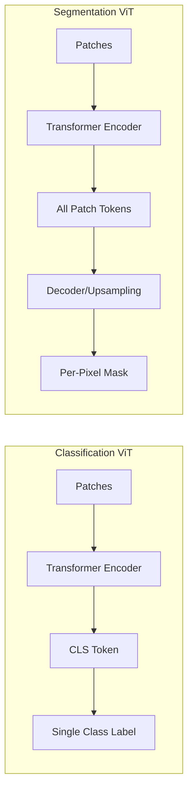
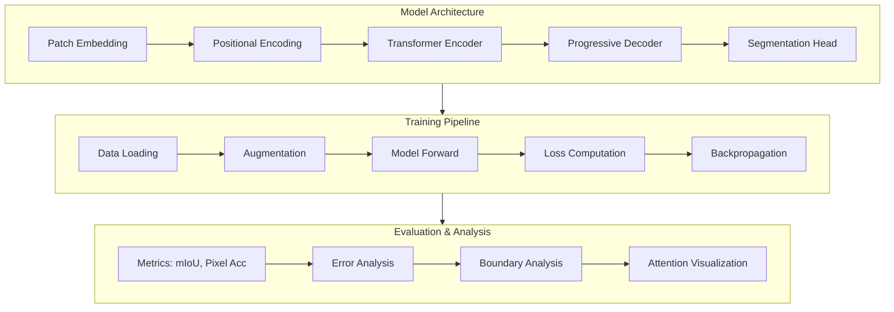

# Vision Transformer for Semantic Segmentation - Tutorial

## Overview

A complete, educational implementation of Vision Transformers for semantic segmentation, built from scratch in PyTorch. This project demonstrates how ViT adapts from classification to dense prediction (per-pixel labels).

**Status:** ✅ Fully implemented and tested

## What You'll Learn

This tutorial covers the complete pipeline for building and training Vision Transformers for semantic segmentation:

1. **Patch Tokens for Dense Prediction** - Using ALL patch tokens, not just CLS
2. **Decoder Design** - How to upsample from patch resolution to pixel resolution
3. **Segmentation Losses** - Cross-entropy, Dice loss, and why both matter
4. **mIoU Metric** - The standard segmentation evaluation metric
5. **Attention in Segmentation** - How attention patterns relate to object boundaries
6. **Training from Scratch** - Complete training pipeline without pretrained weights

## Dataset

**Oxford-IIIT Pets Dataset**
- 7,349 images with pixel-level segmentation masks
- Binary segmentation: pet (foreground) vs. background
- Automatically downloaded via `data/setup_dataset.sh`
- Training: ~2,944 samples | Validation: ~736 samples | Test: 3,669 samples

Perfect for educational purposes - small enough to train quickly (~2 hours on M-series Mac), complex enough to learn real concepts.

## Key Difference: Classification vs Segmentation



## Project Structure

This project is organized into focused modules, each doing one thing well:



## Implementation Overview

```
desertml/
├── vit/
│   ├── __init__.py
│   ├── patch_embed.py        # Patch embedding layer
│   ├── transformer.py        # Attention and transformer blocks  
│   ├── encoder.py            # ViT encoder (combines above)
│   ├── decoder.py            # Upsampling decoder for segmentation
│   ├── segmenter.py          # Complete segmentation model
│   └── losses.py             # Segmentation losses (CE, Dice)
├── data/
│   ├── __init__.py
│   ├── oxford_pets.py        # Oxford Pets dataset loader
│   └── transforms.py         # Image + mask augmentations
├── training/
│   ├── __init__.py
│   ├── trainer.py            # Training loop
│   └── metrics.py            # mIoU, pixel accuracy
├── visualization/
│   ├── __init__.py
│   ├── attention.py          # Attention map visualization
│   └── predictions.py        # Mask overlay visualization
├── scripts/
│   ├── train_scratch.py      # Train from scratch
│   ├── train_pretrained.py   # Fine-tune pretrained model
│   ├── evaluate.py           # Run evaluation
│   └── visualize.py          # Generate visualizations
├── requirements.txt
└── config.py                 # Hyperparameters and paths
```

## Components We'll Build

### Phase 1: ViT Encoder (from scratch)

| File | Component | Purpose |
|------|-----------|---------|
| `patch_embed.py` | `PatchEmbedding` | Split image into patches, project to embeddings |
| `transformer.py` | `MultiHeadAttention` | Self-attention across patches |
| `transformer.py` | `TransformerBlock` | Attention + MLP with residuals |
| `encoder.py` | `ViTEncoder` | Stack of transformer blocks |

### Phase 2: Segmentation Decoder

| File | Component | Purpose |
|------|-----------|---------|
| `decoder.py` | `LinearDecoder` | Simple linear projection (like SETR-Naive) |
| `decoder.py` | `ProgressiveDecoder` | Multi-stage upsampling (like SETR-PUP) |
| `segmenter.py` | `Segmenter` | Encoder + Decoder + Segmentation head |

### Phase 3: Training

| File | Component | Purpose |
|------|-----------|---------|
| `oxford_pets.py` | `OxfordPetsDataset` | Load images and segmentation masks |
| `transforms.py` | `SegmentationTransforms` | Joint image+mask augmentation |
| `trainer.py` | `Trainer` | Training loop with MPS, checkpointing |
| `metrics.py` | `mIoU`, `PixelAccuracy` | Segmentation metrics |
| `losses.py` | `DiceLoss`, `FocalLoss` | Better than pure cross-entropy |

### Phase 4: Visualization

| File | Component | Purpose |
|------|-----------|---------|
| `attention.py` | `visualize_attention` | Attention heatmaps per head/layer |
| `predictions.py` | `overlay_mask` | Show predicted mask on image |

### Phase 5: Pretrained Models

| File | Component | Purpose |
|------|-----------|---------|
| `train_pretrained.py` | Fine-tuning | Use SegFormer from HuggingFace |

## Key Concepts We'll Cover

1. **Patch Tokens for Dense Prediction** - Using ALL patch tokens, not just CLS
2. **Decoder Design** - How to upsample from patch resolution to pixel resolution
3. **Segmentation Losses** - Cross-entropy, Dice loss, and why both matter
4. **mIoU Metric** - The standard segmentation evaluation metric
5. **Attention in Segmentation** - How attention patterns relate to object boundaries
6. **Multi-scale Features** - Why ViT struggles with fine details (and how decoders help)

## Quick Start Guide

### 1. Setup
```bash
python3 -m venv venv
source venv/bin/activate
pip install -r requirements.txt
bash data/setup_dataset.sh
```

### 2. Verify Installation
```bash
python examples/sanity_check.py
```

### 3. Train Model
```bash
python train.py --name my_experiment
```

### 4. Evaluate
```bash
python evaluate.py --checkpoint checkpoints/my_experiment_*/best_model.pth
python evaluate_enhanced.py --checkpoint checkpoints/my_experiment_*/best_model.pth --phase all
```

### 5. Visualize
```bash
python tools/visualize_predictions.py --checkpoint checkpoints/my_experiment_*/best_model.pth
python tools/visualize_attention.py --checkpoint checkpoints/my_experiment_*/best_model.pth
```

## Expected Results

**Training from scratch (50 epochs, ~2 hours on M-series Mac):**
- Validation mIoU: **0.75-0.80** (good for no pretrained weights)
- Pixel Accuracy: **0.90-0.92**
- Background IoU: **0.85-0.88**
- Foreground (pet) IoU: **0.65-0.75**

**What you'll observe:**
- Clean segmentation on simple backgrounds
- Reasonable pet boundaries (not pixel-perfect)
- Struggles with very small pets and complex backgrounds
- ~20-30% accuracy gap between boundaries and interior (normal for ViT)

## Using This Project with AI Assistants

This project is designed to be explored with AI coding assistants like Cursor, Claude, or GitHub Copilot:

### Recommended Exploration Flow

1. **Understand the Architecture**
   - Start with `vit/segmenter.py` to see the full model
   - Ask: "Explain how the encoder and decoder connect"
   - Trace through `vit/patch_embed.py` → `vit/encoder.py` → `vit/decoder.py`

2. **Explore the Training Pipeline**
   - Read `train.py` to understand the setup
   - Examine `training/trainer.py` for the training loop
   - Ask: "How does early stopping work?" or "Explain the loss function"

3. **Analyze the Data Pipeline**
   - Look at `data/oxford_pets.py` for dataset loading
   - Check `data/transforms.py` for augmentation
   - Ask: "Why do we need joint image-mask transforms?"

4. **Dive Into Evaluation**
   - Compare `evaluate.py` vs `evaluate_enhanced.py`
   - Explore `evaluation/analysis.py`
   - Ask: "How is boundary analysis computed?"

5. **Visualize and Debug**
   - Run visualization scripts with checkpoints
   - Ask: "Why do attention maps look different at each layer?"
   - Experiment with `config.py` parameters

### Good Questions to Ask Your AI Assistant

**Architecture Questions:**
- "How does patch embedding convert images to tokens?"
- "Why use progressive upsampling instead of direct upsampling?"
- "What's the difference between self-attention in ViT vs. CNNs?"

**Training Questions:**
- "Why combine Dice loss and Cross-Entropy?"
- "How does the learning rate scheduler affect convergence?"
- "What causes the boundary accuracy gap?"

**Implementation Questions:**
- "Show me where positional encoding is added"
- "How are the attention maps extracted for visualization?"
- "Walk me through one forward pass from image to segmentation mask"

**Improvement Questions:**
- "How could we improve small object segmentation?"
- "What would change if we used pretrained weights?"
- "How would multi-scale features help?"

### Example AI Session

```
You: "I want to understand how this ViT segments images. Start with the high-level flow."

AI: [Explains: Image → Patches → Encoder → Decoder → Mask]

You: "Show me the code where patches are created."

AI: [Opens vit/patch_embed.py, explains Conv2d projection]

You: "How do we get from 14×14 patches back to 224×224 pixels?"

AI: [Opens vit/decoder.py, explains progressive upsampling]

You: "Run a training experiment with smaller model (EMBED_DIM=256, NUM_LAYERS=4)"

AI: [Modifies config.py, runs training, compares results]
```

## Documentation

Extensive documentation in `docs/`:
- `activation_functions.md` - GELU vs ReLU in transformers
- `boundary_analysis.md` - Edge detection in segmentation
- `data_augmentation.md` - Joint image-mask transforms
- `decoder_architectures.md` - Different upsampling strategies
- `evaluation_metrics.md` - IoU, pixel accuracy, and more
- `segmentation_losses.md` - Dice, CE, Focal losses
- `training_loop.md` - Training pipeline details
- `visualization.md` - Attention and prediction visualization

## Learning Path Recommendations

**Beginner (New to ViT):**
1. Read README.md for overview
2. Run `sanity_check.py` to verify setup
3. Explore `vit/segmenter.py` to see full architecture
4. Run training with default config
5. Visualize predictions and attention maps

**Intermediate (Familiar with Transformers):**
1. Compare `vit/encoder.py` with NLP transformers
2. Study `vit/decoder.py` upsampling approach
3. Experiment with `config.py` hyperparameters
4. Analyze results with `evaluate_enhanced.py`
5. Read `docs/decoder_architectures.md`

**Advanced (Want to Modify/Extend):**
1. Implement different decoder architectures
2. Try pretrained ViT weights (from timm/HuggingFace)
3. Add multi-scale features
4. Experiment with different loss functions
5. Scale to larger datasets (ADE20K, COCO)

## Code Quality Principles

This project follows clean code principles:
- **Short files** - Each file < 200 lines
- **Single responsibility** - One purpose per function/class
- **Meaningful names** - No cryptic abbreviations
- **Minimal comments** - Code explains itself
- **Top-down readability** - Read like a story
- **No side effects** - Functions are pure where possible
- **Early returns** - Avoid nested conditionals

See `CONTRIBUTING.md` for detailed guidelines.
