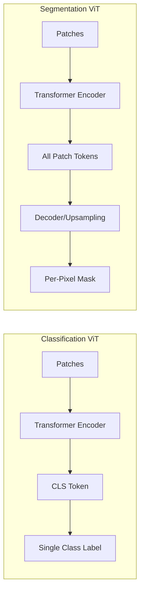
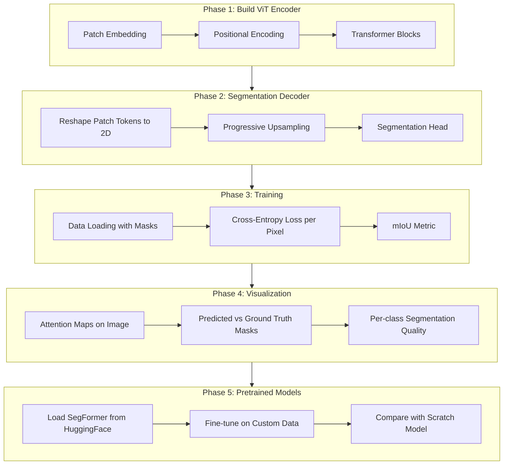

# Vision Transformer for Semantic Segmentation - Tutorial

## Overview

We'll build a complete understanding of Vision Transformers for semantic segmentation through hands-on coding in Python files. Since you're familiar with Transformers from NLP, we'll focus on how ViT adapts from classification to dense prediction (per-pixel labels).

## Dataset

**Oxford-IIIT Pets** - 7K images with pixel-level segmentation masks (pet/background/border). Small enough for quick M3 training, real enough to learn the concepts. We can scale to Pascal VOC or ADE20K later.

## Key Difference: Classification vs Segmentation



## Tutorial Structure



## File Structure

```
desertml/
├── vit/
│   ├── __init__.py
│   ├── patch_embed.py        # Patch embedding layer
│   ├── transformer.py        # Attention and transformer blocks  
│   ├── encoder.py            # ViT encoder (combines above)
│   ├── decoder.py            # Upsampling decoder for segmentation
│   ├── segmenter.py          # Complete segmentation model
│   └── losses.py             # Segmentation losses (CE, Dice)
├── data/
│   ├── __init__.py
│   ├── oxford_pets.py        # Oxford Pets dataset loader
│   └── transforms.py         # Image + mask augmentations
├── training/
│   ├── __init__.py
│   ├── trainer.py            # Training loop
│   └── metrics.py            # mIoU, pixel accuracy
├── visualization/
│   ├── __init__.py
│   ├── attention.py          # Attention map visualization
│   └── predictions.py        # Mask overlay visualization
├── scripts/
│   ├── train_scratch.py      # Train from scratch
│   ├── train_pretrained.py   # Fine-tune pretrained model
│   ├── evaluate.py           # Run evaluation
│   └── visualize.py          # Generate visualizations
├── requirements.txt
└── config.py                 # Hyperparameters and paths
```

## Components We'll Build

### Phase 1: ViT Encoder (from scratch)

| File | Component | Purpose |
|------|-----------|---------|
| `patch_embed.py` | `PatchEmbedding` | Split image into patches, project to embeddings |
| `transformer.py` | `MultiHeadAttention` | Self-attention across patches |
| `transformer.py` | `TransformerBlock` | Attention + MLP with residuals |
| `encoder.py` | `ViTEncoder` | Stack of transformer blocks |

### Phase 2: Segmentation Decoder

| File | Component | Purpose |
|------|-----------|---------|
| `decoder.py` | `LinearDecoder` | Simple linear projection (like SETR-Naive) |
| `decoder.py` | `ProgressiveDecoder` | Multi-stage upsampling (like SETR-PUP) |
| `segmenter.py` | `Segmenter` | Encoder + Decoder + Segmentation head |

### Phase 3: Training

| File | Component | Purpose |
|------|-----------|---------|
| `oxford_pets.py` | `OxfordPetsDataset` | Load images and segmentation masks |
| `transforms.py` | `SegmentationTransforms` | Joint image+mask augmentation |
| `trainer.py` | `Trainer` | Training loop with MPS, checkpointing |
| `metrics.py` | `mIoU`, `PixelAccuracy` | Segmentation metrics |
| `losses.py` | `DiceLoss`, `FocalLoss` | Better than pure cross-entropy |

### Phase 4: Visualization

| File | Component | Purpose |
|------|-----------|---------|
| `attention.py` | `visualize_attention` | Attention heatmaps per head/layer |
| `predictions.py` | `overlay_mask` | Show predicted mask on image |

### Phase 5: Pretrained Models

| File | Component | Purpose |
|------|-----------|---------|
| `train_pretrained.py` | Fine-tuning | Use SegFormer from HuggingFace |

## Key Concepts We'll Cover

1. **Patch Tokens for Dense Prediction** - Using ALL patch tokens, not just CLS
2. **Decoder Design** - How to upsample from patch resolution to pixel resolution
3. **Segmentation Losses** - Cross-entropy, Dice loss, and why both matter
4. **mIoU Metric** - The standard segmentation evaluation metric
5. **Attention in Segmentation** - How attention patterns relate to object boundaries
6. **Multi-scale Features** - Why ViT struggles with fine details (and how decoders help)

## Execution Flow

```
# Step 1: Train from scratch
python scripts/train_scratch.py

# Step 2: Evaluate and visualize
python scripts/evaluate.py
python scripts/visualize.py

# Step 3: Compare with pretrained
python scripts/train_pretrained.py
```

## Expected Outcomes

After completing this tutorial, you'll be able to:
- Build a Vision Transformer encoder from scratch
- Design decoders for dense prediction tasks
- Train segmentation models on custom datasets
- Interpret attention patterns for segmentation
- Fine-tune pretrained segmentation transformers
- Evaluate with proper segmentation metrics (mIoU)

## Estimated Time

- Phase 1-2 (Build encoder + decoder): ~45 min
- Phase 3 (Training): ~30 min  
- Phase 4 (Visualization): ~15 min
- Phase 5 (Pretrained fine-tuning): ~20 min

Total: ~2 hours of interactive learning

## Implementation Todos

- [ ] Create requirements.txt and config.py with MPS device detection
- [ ] Implement PatchEmbedding in patch_embed.py
- [ ] Build MultiHeadAttention and TransformerBlock in transformer.py
- [ ] Assemble ViTEncoder in encoder.py
- [ ] Create segmentation decoder in decoder.py
- [ ] Build complete Segmenter model in segmenter.py
- [ ] Set up Oxford Pets data loading with mask augmentation
- [ ] Implement training loop with segmentation losses
- [ ] Create mIoU and evaluation metrics
- [ ] Build attention visualization utilities
- [ ] Create mask prediction visualization
- [ ] Add pretrained SegFormer fine-tuning script
